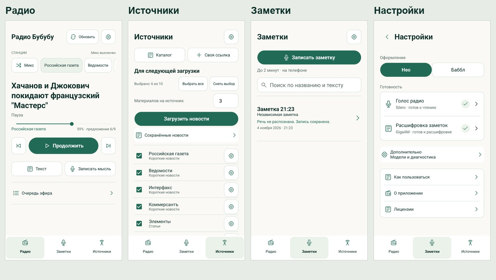
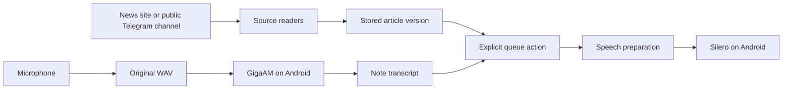

# Radio Bububu · Android

An archived, non-commercial prototype of a personal news radio with **on-device speech synthesis and transcription**. It turns selected articles from news sites and public Telegram channels into a listening queue. The interface and speech processing are in Russian.

Development ended in November 2026. The application was built and tested on a physical Android phone, but was never released to production. This repository preserves the implementation, the evaluation approach and the known limits of the experiment.

*Actual UI from build 54, not a screenshot of the final build 60.*

## The user flow

1. Paste a news-site URL or a public Telegram channel into one input field.
2. Choose a publication, inspect its extracted text and save that version.
3. Explicitly add it to the radio queue and start playback.
4. Pause, continue or move to another article. Optionally record a voice note and transcribe it locally.

The application discovers RSS/Atom feeds and can extract article links from supported HTML layouts. Downloading a text, adding it to the queue and playing it are separate actions. Generic HTML and public Telegram previews can retain an `unknown` completeness status; the user reviews the available text before explicitly adding its version to the queue.

## What the prototype explores

The main engineering problem was the boundary between messy source text and a strict speech model. A headline can look correct while an unsupported character makes a whole sentence disappear from the generated audio.

Radio Bububu keeps an immutable source version and builds a separate speech representation tied to its original UTF-16 ranges. Contextual rules handle selected families of dates, numbers, units, typography, captions and Telegram formatting. The position in the original article remains usable for playback and diagnostics, and the speech cache includes the rule revision.

The runtime does not ask a cloud LLM to rewrite news. Earlier model-based text-normalization experiments gave little benefit on the measured examples and introduced regressions. The final implementation uses bounded, testable rules alongside the local speech models.

## Architecture

A single Android module, written in Java 17 with native Views.

| Area | Main entry points |
|---|---|
| Discovery, download and source identity | `SourceCoordinator`, `SafeHttpTransport`, feed/HTML/Telegram readers |
| Versioned content and persistent state | `SourceVersionRecord`, `NoteBook`, content-addressed source cache |
| Playback and continuation | `PlayerController`, `RadioService`, `SpeechRouter` |
| Text-to-speech preparation | `ContextualSpeech`, `SourceSpeechPlan45`, `SileroSpeechInput` |
| Local ML integration | `ModelsController`, flavor-specific `NativeModels` |

The experimental build uses Silero TTS and GigaAM ASR on the device. The network is needed to fetch publications; these local speech engines do not send the text or audio to a speech API.

## Evidence and limits

The evaluation separated text preparation, actual Android PCM generation and physical speaker output captured by an external microphone. Inputs and candidate versions were frozen before opening new control sets.

- Build **57** passed five real source-to-playback-start flows across websites and a public Telegram channel.
- Build **59** generated audio for all **82 sentences** of ten previously examined, re-extracted texts. On a new five-document control set, **34 of 36 sentences** passed text preparation.
- The last development build, **60**, passed **1,039 unit tests**, with **10 skipped**, on 5 November 2026. It was built and installed. Its final full-length phone-audio evaluation and another held-out set were **not run**.

These are historical results for named versions. They are not a claim of flawless pronunciation or production readiness. Foreign words can still be spelled out, some unsupported expressions can reject a fragment, and source extraction depends on publisher markup. The full-quality physical dictation path and Android devices using 16 KiB memory pages remain unaccepted.

See [the archive record](docs/ARCHIVE.md) for methodology and unresolved checks, and [building instructions](docs/BUILDING.md) for the current archive package.

## Build and repository layout

The project uses JDK 17, Gradle 8.13, Android Gradle Plugin 8.13.2, Android SDK 36 and Build Tools 36.0.0. The `experimental` flavor targets Android 9+ and `arm64-v8a`. The `baseline` flavor omits the native models and does not reproduce the complete experiment.

- `app/` — application code and regression tests.
- `gradle/` — wrapper, dependency locks and verification metadata.
- `tools/` — build and reproducibility helpers.
- `docs/` — archive status, build instructions and selected evidence.

Signing keys, user recordings, personal texts, local caches and full copies of third-party news articles are excluded from the public source tree. The model and native-runtime inputs have their own distribution terms. Follow [BUILDING.md](docs/BUILDING.md) to obtain and verify the correct inputs.

## Credits and licensing

Own application code is published under the [MIT License](LICENSE). This does **not** relicense third-party code, model weights, derived model packages or publisher content.

The speech work builds on [Silero Models](https://github.com/snakers4/silero-models) and [GigaAM](https://github.com/salute-developers/GigaAM). Android integration also uses PyTorch, sherpa-onnx and ONNX Runtime; networking and HTML parsing use OkHttp and jsoup. See [THIRD_PARTY.md](THIRD_PARTY.md) and the model conditions accompanying the archived build inputs before reuse, especially for commercial use.

News articles and Telegram publications remain the property of their authors and publishers. This archive contains no endorsement or affiliation with them.
